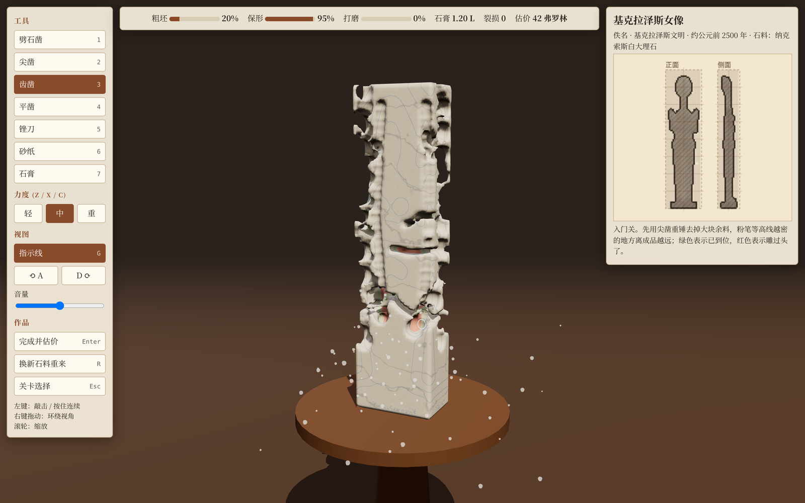
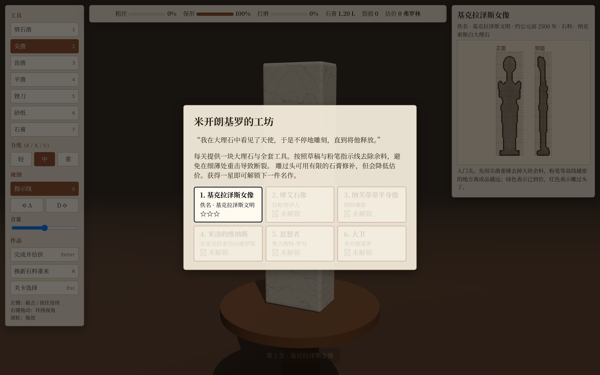
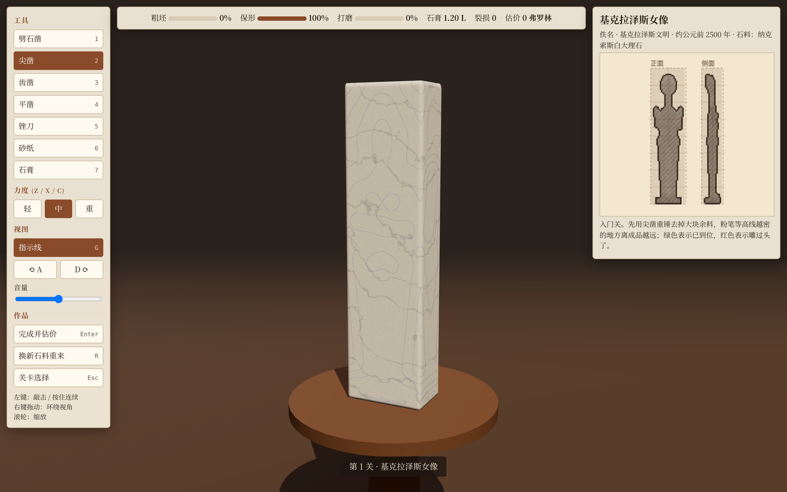
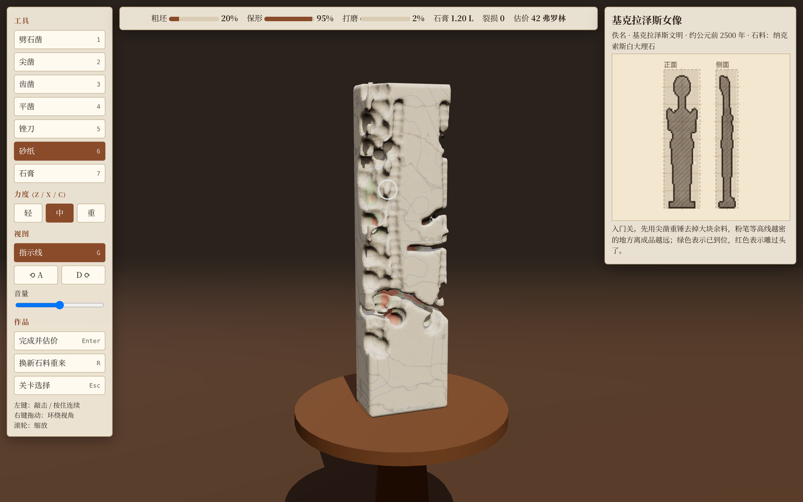
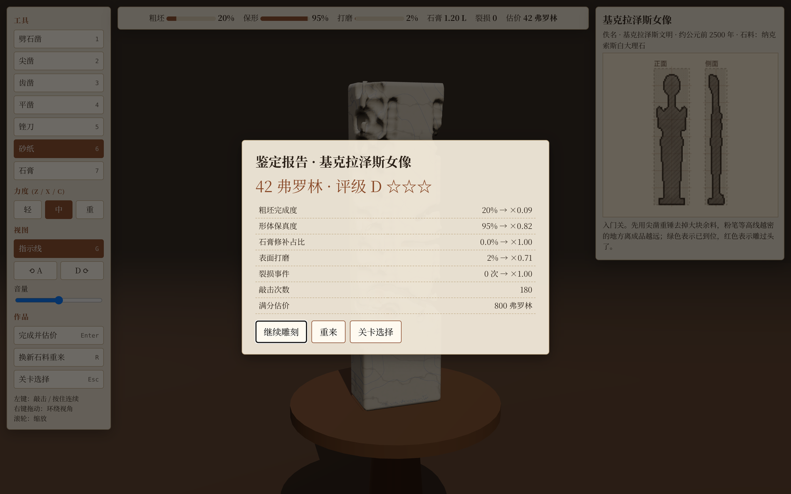

<div align="center">

# 米开朗基罗的工坊

**Michelangelo's Workshop** · 浏览器里的三维大理石雕刻模拟器

> 「我在大理石中看见了天使，于是不停地雕刻，直到将他释放。」 —— 米开朗基罗

用凿子、锤子与砂纸，把一整块大理石从粗坯雕成六件传世名作。
体素 / SDF 引擎在浏览器里实时模拟去料、崩裂与打磨，每一刀都不可撤销。

[](https://threejs.org/)
[](https://vite.dev/)
[](https://vitest.dev/)

</div>

---

## 简介

《米开朗基罗的工坊》是一个纯前端的雕刻模拟器。每一关给出一块大理石和一套传统雕刻工具，你按照草稿与粉笔指示线层层去除余料，避开隐藏的瑕疵，最终完成一件雕塑并接受估价。

它不是「涂改式」的建模：石料被表示为一个体素标量场，凿击、崩裂、修补都会真实地改变场内数据；雕过头无法撤销，只能用有限的石膏修补，而修补会降低估价。



## 玩法

- **对照草稿**：右侧面板给出目标雕塑的正面 / 侧面铅笔稿与比例线，粉笔指示线显示当前石料离成品还有多远。
- **分层去料**：先用劈石凿、尖凿粗坯，再用齿凿、平凿收形，最后锉平、打磨、上光。
- **小心崩裂**：在细薄处或纹理附近重击会断裂、甚至整块崩落，伤及成品就会计入裂损。
- **鉴定估价**：完成度、保真度、石膏占比、表面打磨与裂损次数共同决定最终价格与星级。

### 工具

| 键 | 工具 | 模式 | 冲击 | 说明 |
| :-: | :--- | :--- | :-: | :--- |
| `1` | 劈石凿 | 劈裂 | 2.2 | 在棱角附近制造裂面，让整块余料崩落；离成品近时极危险 |
| `2` | 尖凿 | 雕刻 | 1.5 | 粗坯主力，去料快、冲击大 |
| `3` | 齿凿 | 雕刻 | 0.9 | 中等去料，用于贴近成品轮廓 |
| `4` | 平凿 | 雕刻 | 0.4 | 精修细节，几乎不会开裂 |
| `5` | 锉刀 | 锉平 | 0 | 沿表面薄薄地锉平，不会开裂 |
| `6` | 砂纸 | 打磨 | 0 | 提升光泽与估价 |
| `7` | 石膏 | 修补 | 0 | 修补过雕或裂缝，用量有限且会降低估价 |

力度：`Z` 轻（×0.6）· `X` 中（×1.0）· `C` 重（×1.5）。

### 操作

| 操作 | 说明 |
| :--- | :--- |
| 左键点击 / 按住 | 敲击，按住可连续雕刻 |
| 右键拖动 | 环绕视角 |
| 滚轮 | 缩放 |
| `1`–`7` | 切换工具 |
| `Z` / `X` / `C` | 切换轻 / 中 / 重力度 |
| `G` | 显示或隐藏粉笔指示线 |
| `A` / `D` | 转台左转 / 右转 |
| `Enter` | 完成并估价 |
| `R` | 换一块新石料重来 |
| `Esc` | 打开关卡选择 |

## 关卡

六件名作，难度与风险递增。`瑕疵` 表示石材内部隐藏弱脉的密度，越高越容易在重击下崩裂。

| # | 作品 | 原作者 | 年代 | 石料 | 瑕疵 | 满分估价 |
| :-: | :--- | :--- | :--- | :--- | :-: | --: |
| 1 | 基克拉泽斯女像 | 佚名 · 基克拉泽斯文明 | 约公元前 2500 年 | 纳克索斯白大理石 | 0.00 | 800 弗罗林 |
| 2 | 摩艾石像 | 拉帕努伊人 | 1250–1500 年 | 大理石（原作为凝灰岩） | 0.15 | 1,500 |
| 3 | 纳芙蒂蒂半身像 | 图特摩斯 | 公元前 1345 年 | 大理石（原作为石灰岩彩绘） | 0.30 | 4,000 |
| 4 | 米洛的维纳斯 | 安条克的亚历山德罗斯 | 公元前 150–125 年 | 帕罗斯大理石 | 0.45 | 9,000 |
| 5 | 思想者 | 奥古斯特·罗丹 | 1904 年 | 大理石（原作为青铜） | 0.60 | 16,000 |
| 6 | 大卫 | 米开朗基罗 | 1501–1504 年 | 卡拉拉大理石 | 0.80 | 50,000 |

获得一星即可解锁下一件名作。

## 评分

估价由若干相互独立的因子相乘得到，任何一项做砸都会显著拉低总价：

| 因子 | 计算 | 含义 |
| :--- | :--- | :--- |
| 粗坯完成度 | `完成度 ^ 1.5` | 余料是否去除干净 |
| 形体保真度 | `保真度 ^ 4` | 是否伤及雕像本体，权重最高 |
| 石膏修补 | `1 − min(0.8, 石膏占比 × 6)` | 修补越多掉价越快 |
| 表面打磨 | `0.7 + 0.3 × 打磨` | 未打磨只能卖到七成 |
| 裂损事件 | `0.93 ^ 裂损次数` | 每一次伤及本体的断裂都计罚 |

```
价值 = 满分估价 × 完成度(^1.5) × 保真度(^4) × 石膏因子 × 打磨因子 × 裂损因子
```

评级按 `价值 / 满分估价` 划分：**S** ≥ 0.85 · **A** ≥ 0.65 · **B** ≥ 0.45 · **C** ≥ 0.25 · 其余 **D**；
对应星级：≥ 0.65 三星、≥ 0.4 两星、≥ 0.2 一星。当保真度低于 0.72 时判定为**作品损毁**。

## 运行截图

| 关卡选择与草稿 | 粗坯与粉笔指示线 |
| :-: | :-: |
|  |  |

| 雕刻中的粉尘与碎屑 | 鉴定报告 |
| :-: | :-: |
|  |  |

## 快速开始

需要 Node.js ≥ 18 与支持 WebGL2 的现代浏览器。

```bash
git clone https://github.com/our0boros/Michelangelo.git
cd Michelangelo
npm install
npm run dev          # 打开 http://localhost:5173/
```

其他脚本：

| 命令 | 作用 |
| :--- | :--- |
| `npm run dev` | 启动 Vite 开发服务器（热更新） |
| `npm run build` | 打包到 `dist/` |
| `npm run preview` | 预览打包结果 |
| `npm test` | 运行 Vitest 单元测试 |

仓库还附带一个开发服务器管理脚本：

```bash
./dev.sh start     # 后台启动
./dev.sh status    # 查看状态与访问地址
./dev.sh logs      # 实时查看日志
./dev.sh stop      # 停止
./dev.sh restart   # 重启
```

> 项目通常位于 Windows 挂载盘（`/mnt/*`）。由于该文件系统不派发 inotify 事件，Vite 会自动改用轮询监听模块变更（见 `vite.config.js`）。

## 技术实现

| 模块 | 职责 |
| :--- | :--- |
| `src/sdf.js` | 最小有符号距离（SDF）工具箱：球、椭球、胶囊、圆角盒、布尔与镜像 |
| `src/sculptures.js` | 六件名作的简化 SDF 造型 |
| `src/grid.js` | 体素石材：`field`（石料）、`target`（参考形体）、`flaw`（隐藏弱脉）、`plaster`、`polish` 五层标量场，含射线求交、探针与脏区追踪 |
| `src/noise.js` | 确定性 3D 值噪声与 fBm，用于大理石纹脉与隐藏瑕疵 |
| `src/tools.js` | 工具表与球形体素笔刷（雕刻 / 修补 / 打磨） |
| `src/fracture.js` | 敲击、开裂概率评估、不规则平面裂面，以及基于连通性的碎块脱落 |
| `src/mesher.js` | Surface Nets 表面提取，输出带目标距离 / 石膏 / 打磨属性的网格 |
| `src/marble.js` | 大理石材质：程序化纹理、石膏与打磨表现、粉笔等高线着色器 |
| `src/stoneMesh.js` | 分块网格，每刀只重建「脏」块 |
| `src/scene.js` | 渲染器、影棚灯光、转台、碎屑刚体与粉尘粒子 |
| `src/sketch.js` | 正面 / 侧面铅笔草稿与进度叠加 |
| `src/scoring.js` | 估价与评级（纯函数，可脱离 WebGL 测试） |
| `src/audio.js` | 程序化 WebAudio 音效（凿击、锉磨、断裂、落地） |
| `src/ui.js` | DOM 工具面板、实时数据、弹窗与进度存档（localStorage） |

几处设计取舍：

- **体素场而非网格编辑**：石料是 `field > 0` 的标量场，雕刻是场上的球体布尔运算，因此去料、修补、崩裂可以共享同一套物理与渲染。
- **分块增量网格化**：石料按 16³ 单元切块，一次敲击只重建受影响的块，数千次击打仍能保持实时。
- **开裂是概率事件**：局部最薄厚度、隐藏弱脉与工具冲击共同决定断裂风险，悬停圈会以白→红提示风险。
- **碎块真正会掉**：每次敲击后从固定端做洪水填充，与主体断开的部分被抽取为独立网格并做抛物线运动。

## 项目结构

```
Michelangelo/
├── index.html            # 页面骨架与 DOM 面板
├── vite.config.js        # 打包与轮询监听配置
├── dev.sh                # 开发服务器管理脚本
├── src/                  # 引擎与游戏逻辑（见上表）
├── test/engine.test.js   # 估价、断裂与连通性单元测试
└── docs/images/          # README 截图
```

## 测试

`src/scoring.js` 与 `src/fracture.js` 的核心逻辑是网格状态的纯函数，可在没有 WebGL 的情况下直接测试：

```bash
npm test
```

覆盖估价上限、未动石料的价值、石膏修补折算、损毁判定，以及整块切断与劈裂脱块等场景。

---

<div align="center">
由 <a href="https://github.com/our0boros">our0boros</a> 制作 · 用 Three.js 在浏览器中重现大理石与凿子
</div>
